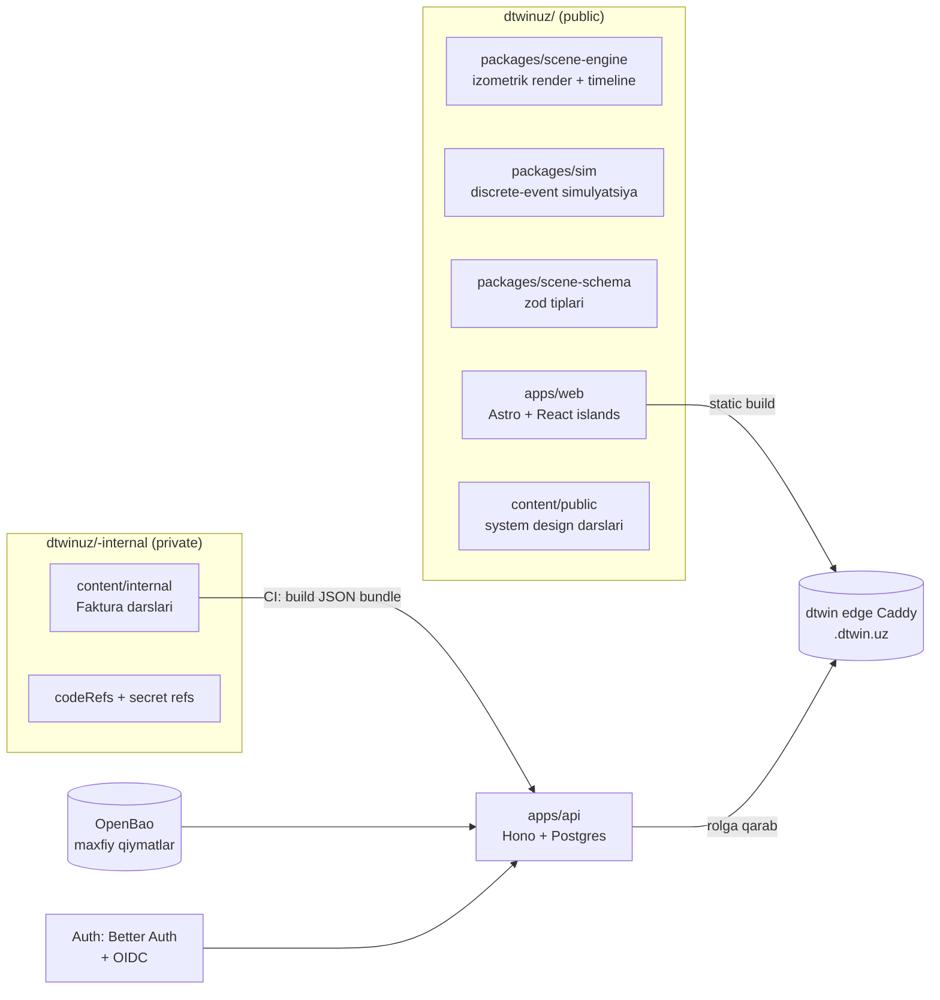
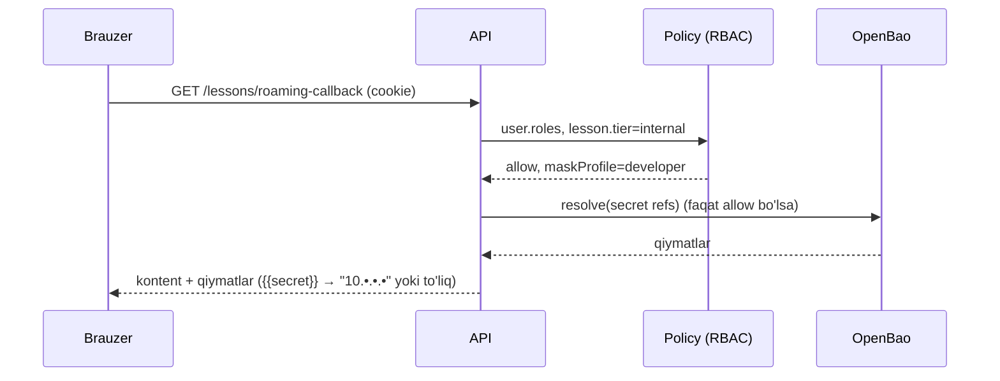

# 04 · Arxitektura

## 1. Umumiy ko'rinish


**Asosiy tamoyil:** public kontent statik va tez bo'ladi. Ichki kontent faqat API orqali, sessiya va rol tekshirilgandan keyin beriladi. Maxfiy qiymatlar kontentda **havola** sifatida turadi (`{{secret:faktura.prod.db-host}}`), qiymatning o'zi yozilmaydi.

## 2. Stek (tanlov va sabab)
| Qatlam | Tanlov | Nega | Rad etilgan |
|---|---|---|---|
| Sayt qobig'i | **Astro 5** + MDX + Content Collections | Statik public darslar, SEO, i18n routing, island'lar faqat kerak joyda JS beradi. wonmor.io naqshi bilan bir xil | Next.js: SSR server shart, og'irroq. Vite SPA: SEO va i18n qo'lda |
| Interaktiv qism | **React 19** island'lar (Player, Lab, Practice) | Ekotizim: xyflow, Motion | Svelte: jamoa tajribasi kam |
| Animatsiya | **Motion** (SVG) + Canvas2D paket qatlami (keyin PixiJS) | Aniq, theme token, a11y; samwho ham PixiJS'dan SVG'ga o'tgan | three.js: darslar uchun og'ir |
| Sahna tavsifi | **TS DSL** (`scene.ts`) + zod validatsiya | Tip xavfsizligi, IDE yordami, meros va diff | YAML: tip yo'q. LikeC4 to'g'ridan: izometrik sahna va metrikani bermaydi (lekin eksport/import ko'prigi keyin) |
| Simulyatsiya | O'z DES dvigatelimiz (`packages/sim`), Web Worker'da | Metrika o'lchanadi; Lab bilan bir xil dvigatel | Faqat skript animatsiya: "nima bo'ladi, agar"ga javob bermaydi |
| Qidiruv | **Pagefind** | Statik, uch til, serversiz | Algolia: tashqi servis |
| API | **Hono** (Node 24 LTS) + **Drizzle** + **Postgres 17** | Yengil, TS bir xil, edge/Node'da ishlaydi | NestJS: shu hajm uchun og'ir |
| Auth | **Better Auth** (email, GitHub/Google OAuth, organization + roles plugin) | TS'da, o'z bazamizda, OIDC qo'shish oson | Keycloak: og'ir (JVM). Zitadel: alohida servis (keyin SSO kerak bo'lsa ADR) |
| Ruxsat | O'z RBAC + ABAC jadvali → keyin kerak bo'lsa **Cerbos** | Boshlanishiga oddiy; policy'lar fayl sifatida testlanadi | OpenFGA: hozircha ortiqcha |
| Maxfiy qiymatlar | **OpenBao** KV (mavjud) | Infra'da allaqachon bor | `.env`da: audit yo'q |
| Monorepo | **pnpm workspaces** (+ Turborepo 6+ paketda) | Sodda | Nx: og'ir |

## 3. Sahna DSL (eskiz)
```ts
export default lesson({
  slug: "load-balancing", level: "beginner", minutes: 12,
  nodes: { users: actor("users"), lb: node("lb"), a: server("a"), b: server("b") },
  metrics: ["users", "rps", "p95", "errors", "healthy"],
  sim: { arrival: poisson(6000), service: { a: lat(40), b: lat(40) } },
  steps: [
    step("hot-spot",  { kind: "problem", show: ["users", "a"], edges: [["users","a"]] }),
    step("add-lb",    { kind: "fix", add: ["lb", "b"], edges: [["users","lb"],["lb","a"],["lb","b"]] }),
    step("lb-fails",  { kind: "problem", set: { lb: "down" }, what: { slider: "lb.mtbf" } }),
  ],
});
```
- Har `step` faqat **o'zgarishni** yozadi (D2 `steps` semantikasi). Engine to'liq holatni yig'adi va oldingisi bilan **diff** qiladi. "WHAT CHANGED" shu diff'dan olinadi; muallif faqat izoh qo'shadi.
- Matnlar alohida: `content/<slug>/{uz,ru,en}.mdx`, har qadam `## step:hot-spot` bo'limi. Tarjimon kodga tegmaydi.
- Ichki darsda qadamga `codeRef: { repo, path, symbol, pinnedSha }` va `secrets: ["faktura.prod.gw-ip"]` qo'shiladi.

## 4. Engine qatlamlari
1. `schema` → validatsiya, `resolve(steps)` → holatlar ketma-ketligi + diff.
2. `layout` → izometrik proyeksiya (2:1), grid, avtomatik joylash (muallif `at:[x,y]` bilan qo'lda tuzatadi).
3. `render-svg` → tugun, edge, yorliq; theme CSS tokenlari (light/dark).
4. `particles` → Canvas2D overlay: paketlar (request, heavy, failed, health-check).
5. `timeline` → qadamlar orasidagi o'tish (Motion), replay, pause, `reduced-motion` rejimi.
6. `sim` (Worker) → hodisalar, metrikalar → plitkalar.
7. `export` → statik SVG/PNG karta, Mermaid, keyinroq Motion Canvas orqali MP4.

## 5. Rol va niqoblash (asosiy farqimiz)

- **3 qatlam kontent:** `public` (statik bundle), `internal` (API orqali, a'zo bo'lsa), `restricted` (API orqali + aniq rol).
- **Niqob profillari:** har maxfiy havolaning turi bor (`ip`, `host`, `table`, `person`, `inn`, `money`) va har rol uchun qoida bor: `full`, `partial` (`10.•.•.45`), `hidden` (`•••`).
- Niqoblash **faqat serverda** bo'ladi. Klient to'liq qiymatni ko'rmaydi: brauzerda yashirish emas, qiymat umuman yuborilmaydi.
- Har ochilish audit jurnaliga yoziladi: kim, qaysi qiymat, qachon.
- CI tekshiruvi: public build ichida `{{secret:` qatori yoki IP/host naqshi bo'lsa build yiqiladi.
- Rollar matritsasi (PM, developer, support, admin, tashqi) — **keyingi bosqich** (user qarori). Hozir mexanizm loyihalanadi, matritsa ADR-0006 da to'ldiriladi.

## 6. Ma'lumotlar modeli (boshlang'ich)
`users`, `orgs`, `memberships(role)`, `progress(user, lesson, step, ts)`, `practice_attempts`, `srs_cards`, `secret_access_log`, `lesson_feedback`.

## 7. Sinxron: darslar va real kod
- Ichki repo'dagi CI Faktura GitLab'ini read-only token bilan oladi va har `codeRef.symbol` hali mavjudligini tekshiradi.
- Topilmasa PR'da ogohlantirish chiqadi va haftalik drift issue ochiladi; build yiqilmaydi.
- `pinnedSha..dev` diff'i faylga tegsa, dars "qayta ko'rilsin" yorlig'ini oladi.
- Ichki host nomlari va GitLab URL'lari **faqat private repo'da va API javobida** turadi, public repo'da hech qachon.
